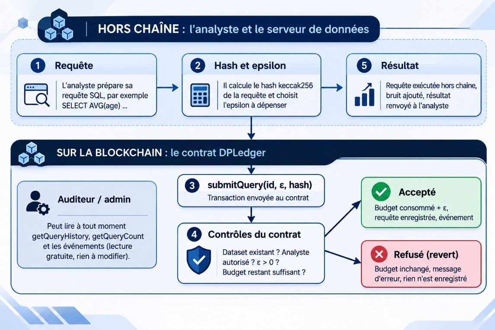

# Differential Privacy Ledger

Registre du budget de confidentialité (**ε**, epsilon) sur une blockchain **Ethereum privée**, développé avec **Geth**, **Truffle** et **Solidity**.


## Présentation

Même anonymisée, une base de données peut révéler des informations personnelles si l'on combine plusieurs requêtes. La confidentialité différentielle limite ce risque en ajoutant du bruit aux résultats, au prix d'un budget de confidentialité **ε** consommé à chaque requête.

**DPLedger** est le registre on-chain de ce budget :

- l'administrateur enregistre un dataset et son budget total ;
- il autorise les analystes habilités ;
- chaque requête consomme une part du budget et est inscrite définitivement dans l'historique ;
- toute modification du budget (augmentation ou remise à zéro) est tracée par un événement.

Le contrat ne calcule pas le bruit : il assure uniquement la **comptabilité du budget**, le **contrôle d'accès** et l'**auditabilité** de l'historique.

## Architecture


Le nœud Geth expose une interface JSON-RPC sur `127.0.0.1:8545`. Truffle s'y connecte pour compiler, tester et déployer le contrat.



| Compte   | Rôle                              |
| -------- | --------------------------------- |
| Compte 0 | Admin : déploie, mine, administre |
| Compte 1 | Analyste autorisé                 |
| Compte 2 | Second analyste (optionnel)       |
| Compte 3 | Intrus : sert aux tests de refus  |

## Stack technique

| Outil    | Version | Usage                          |
| -------- | ------- | ------------------------------ |
| Geth     | 1.11.6  | Nœud Ethereum privé (PoW)      |
| Truffle  | 5.11.5  | Compilation, tests, déploiement |
| Solidity | 0.8.19  | Langage du contrat             |
| Node.js  | 18.x    | Exécution de Truffle           |

L'EVM cible **London**, dernière version compatible avec le minage Proof-of-Work de Geth 1.11.6.

## Structure du projet

```text
.
├── genesis.json                 # Bloc Genesis et allocation des comptes
├── start-node1.ps1              # Lancement du nœud Geth
├── dp-ledger/
│   ├── contracts/DPLedger.sol   # Contrat intelligent
│   ├── migrations/              # Script de déploiement
│   ├── helpers/utils.js         # Fonctions utilitaires des tests
│   ├── test/                    # Tests Truffle
│   ├── truffle-config.js        # Réseau, compilateur et compte déployeur
│   └── package.json             # Scripts et version de Truffle
├── docs/
│   ├── rapport.pdf              # Rapport détaillé du projet
│   └── images/                  # Schémas utilisés dans ce README
└── README.md
```

> `node1/`, `keystore_backup/`, `password.txt` et `geth.exe` ne sont volontairement pas versionnés : ils contiennent les données locales de la chaîne, les clés privées chiffrées et le mot de passe des comptes.

## Prérequis

- Windows avec PowerShell (les commandes sont également adaptables sous Linux/macOS) ;
- [Geth 1.11.6](https://geth.ethereum.org/downloads) — dernière version supportant le minage PoW ;
- [Node.js 18.x](https://nodejs.org) et npm ;
- Git.

## Installation

```powershell
git clone https://github.com/<votre-utilisateur>/<votre-depot>.git
cd <votre-depot>
cd dp-ledger
npm install
```

## Lancer la blockchain

Initialiser le nœud avec le bloc Genesis (une seule fois) :

```powershell
.\geth.exe init --datadir node1 genesis.json
```

Démarrer le nœud et le minage :

```powershell
.\start-node1.ps1
```

Le premier lancement génère le DAG Ethash et peut prendre plusieurs minutes. Laisser ce terminal ouvert : les blocs sont minés en continu.

> Le script déverrouille les comptes avec `--allow-insecure-unlock`. Cette configuration est réservée à un environnement **local de test**.

## Compiler, tester et déployer

Dans un second terminal, depuis la racine du projet :

```powershell
cd dp-ledger

npx truffle compile
npx truffle test --network development
npx truffle migrate --network development
```

| Commande           | Action                                           |
| ------------------ | ------------------------------------------------ |
| `truffle compile`  | Compile le contrat et génère l'ABI dans `build/` |
| `truffle test`     | Exécute les tests sur le réseau `development`    |
| `truffle migrate`  | Déploie `DPLedger` sur la chaîne locale          |

## Utilisation

Ouvrir la console Truffle :

```powershell
npx truffle console --network development
```

Exemple complet :

```javascript
const ledger = await DPLedger.deployed();

// 1. Enregistrer un dataset (budget en milli-epsilon : 1000 = ε 1.0)
await ledger.registerDataset(1, "Dossiers medicaux", 1000, { from: accounts[0] });

// 2. Autoriser un analyste
await ledger.authorizeAnalyst(1, accounts[1], { from: accounts[0] });

// 3. Soumettre une requête (le hash est calculé hors chaîne)
const hash = web3.utils.keccak256("SELECT AVG(age) FROM patients");
await ledger.submitQuery(1, 400, hash, { from: accounts[1] });

// 4. Consulter le budget restant et l'historique
(await ledger.getRemainingBudget(1)).toString(); // "600"
(await ledger.getQueryCount(1)).toString();       // "1"
await ledger.getQueryHistory(1);
```

## API du contrat

| Fonction                                       | Accès              | Description                                          |
| ---------------------------------------------- | ------------------ | ---------------------------------------------------- |
| `registerDataset(id, nom, budgetTotal)`        | Owner              | Enregistre un dataset avec son budget                |
| `authorizeAnalyst(id, analyste)`               | Owner              | Autorise une adresse à interroger le dataset         |
| `submitQuery(id, epsilon, hashRequete)`        | Analyste autorisé  | Consomme le budget et enregistre la requête          |
| `updateBudget(id, nouveauTotal)`               | Owner              | Modifie le budget total (jamais sous le consommé)    |
| `resetBudget(id, raison)`                      | Owner              | Remet le budget consommé à zéro (raison obligatoire) |
| `getRemainingBudget(id)`                       | Lecture            | Budget restant                                       |
| `getDataset(id)`                               | Lecture            | Nom, budget total, consommé et nombre de resets      |
| `getQueryCount(id)`                            | Lecture            | Nombre de requêtes enregistrées                      |
| `getQueryHistory(id)`                          | Lecture            | Historique complet des requêtes                      |

Événements émis : `DatasetRegistered`, `AnalystAuthorized`, `QuerySubmitted`, `BudgetExhausted`, `BudgetUpdated`, `BudgetReset`.

## Tests

```powershell
cd dp-ledger
npx truffle test --network development
```

| Fichier                      | Couverture                                        |
| ---------------------------- | ------------------------------------------------- |
| `01_deploiement.test.js`     | Owner, enregistrement des datasets, validations   |
| `02_autorisation.test.js`    | Autorisation des analystes et refus d'accès        |
| `03_budget.test.js`          | Consommation, cumul, dépassement, budget épuisé   |
| `04_historique.test.js`      | Contenu de l'historique et requêtes refusées      |
| `05_update_budget.test.js`   | Modification du budget total                      |
| `06_reset_budget.test.js`    | Réinitialisation tracée et conservation du journal |

## Comptes et redémarrage

Les comptes définis dans `genesis.json` sont des comptes **de test**. Pour recréer un nœud local à partir de zéro :

```powershell
.\geth.exe --datadir node1 account new   # répéter pour les 4 comptes
```

Reporter ensuite les nouvelles adresses dans `genesis.json`, `start-node1.ps1` et le champ `from` de `dp-ledger/truffle-config.js`, puis relancer `geth init`.

## Sécurité

- Réseau privé à **un seul nœud**, sans découverte de pairs : usage local uniquement.
- Ne jamais publier `password.txt`, `node1/keystore/` ni `keystore_backup/`.
- L'administrateur conserve un pouvoir important (modification et remise à zéro du budget), mais chaque action est tracée on-chain.
- Le contrat fait confiance à l'analyste pour déclarer le bon `ε` ; le calcul du bruit reste hors chaîne.

## Rapport

Le rapport complet du projet est disponible ici : [`docs/rapport.pdf`](docs/rapport.pdf).

## Auteur

**Aya Chakour** — École Nationale des Sciences Appliquées de Tétouan (ENSA Tétouan)
Encadré par **Pr. Imad Sassi** — Année universitaire 2026-2027.

## Licence

Ce projet est distribué sous licence [MIT](LICENSE).
