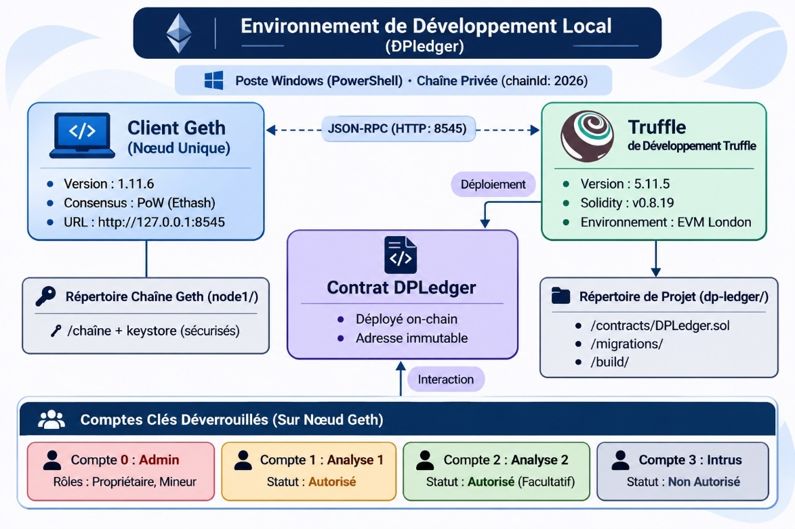

# Differential Privacy Ledger

Registre du budget de confidentialité (ε) sur une blockchain Ethereum privée, développé avec Geth, Truffle et Solidity.


## Présentation

Même anonymisée, une base de données peut révéler des informations personnelles si l'on combine plusieurs requêtes. La confidentialité différentielle limite ce risque en ajoutant du bruit aux résultats, au prix d'un budget de confidentialité **ε** consommé à chaque requête.

**DPLedger** est le registre on-chain de ce budget :
Le contrat DPLedger suit et limite le budget de confidentialité consommé par les requêtes sur une base de données sensible.

- l'administrateur enregistre un dataset et son budget total ;
- il autorise les analystes habilités ;
- chaque requête consomme une part du budget et est inscrite définitivement dans l'historique ;
- toute modification du budget (augmentation ou remise à zéro) est tracée par un événement.
L'administrateur enregistre un dataset et autorise les analystes. Chaque requête consomme une part du budget et reste inscrite définitivement dans l'historique. Toute modification du budget est tracée par un événement.

Le contrat ne calcule pas le bruit : il assure uniquement la **comptabilité du budget**, le **contrôle d'accès** et l'**auditabilité** de l'historique.
Le contrat ne calcule pas le bruit : il gère uniquement le budget, les droits d'accès et l'historique.


## Architecture



Geth expose une interface JSON-RPC sur `127.0.0.1:8545`. Truffle s'y connecte pour compiler, tester et déployer le contrat.


## Structure

```text
.
├── genesis.json
├── start-node1.ps1
├── dp-ledger/
│   ├── contracts/DPLedger.sol
│   ├── migrations/1_deploy_dpledger.js
│   ├── helpers/utils.js
│   ├── test/
│   ├── truffle-config.js
│   └── package.json
├── docs/images/
└── README.md
```

## Prérequis

- Geth 1.11.6 (minage Proof-of-Work)
- Node.js 18 et npm
- Truffle 5.11.5 (installé par `npm install`)
- Git

## Installation

```powershell
git clone https://github.com/<utilisateur>/dp-ledger_Blockchain.git
cd dp-ledger_Blockchain
cd dp-ledger
npm install
```

## Lancer la blockchain

```powershell
.\geth.exe init --datadir node1 genesis.json
.\start-node1.ps1
```

Le premier lancement peut prendre plusieurs minutes (génération du DAG Ethash). Garder ce terminal ouvert.

## Compiler, tester et déployer

Dans un second terminal :

```powershell
cd dp-ledger
npx truffle compile
npx truffle test --network development
npx truffle migrate --network development
```

## Utilisation

```powershell
npx truffle console --network development
```

```javascript
const ledger = await DPLedger.deployed();

await ledger.registerDataset(1, "Dossiers medicaux", 1000, { from: accounts[0] });
await ledger.authorizeAnalyst(1, accounts[1], { from: accounts[0] });

const hash = web3.utils.keccak256("SELECT AVG(age) FROM patients");
await ledger.submitQuery(1, 400, hash, { from: accounts[1] });

(await ledger.getRemainingBudget(1)).toString(); // "600"
```

## Fonctions du contrat

- `registerDataset(id, nom, budgetTotal)` : enregistre un dataset.
- `authorizeAnalyst(id, analyste)` : autorise un analyste.
- `submitQuery(id, epsilon, hashRequete)` : consomme le budget et enregistre la requête.
- `updateBudget(id, nouveauTotal)` : modifie le budget total.
- `resetBudget(id, raison)` : remet le budget consommé à zéro.
- `getRemainingBudget`, `getDataset`, `getQueryCount`, `getQueryHistory` : lecture de l'état.

## Tests

Les 28 tests Truffle couvrent le déploiement, les autorisations, la consommation du budget, l'historique, la mise à jour et le reset.

```powershell
cd dp-ledger
npx truffle test --network development
```
